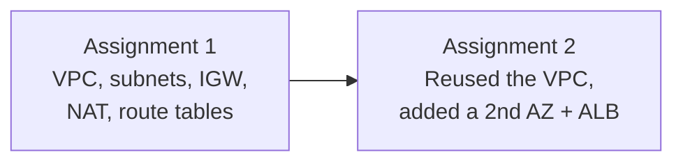

# AWS: Cloud Networking & Load Balancing

Hands-on AWS work from the CoderCo AWS module. Everything was built by hand in the AWS console (London, eu-west-2), tested, documented and then cleaned up to control costs.

## Assignments

| | Assignment | What I built | Key skills |
|---|---|---|---|
| 1 | [Custom VPC & Networking](assignment-1-vpc/) | A VPC from scratch with public and private subnets, an Internet Gateway, a NAT Gateway, route tables and two EC2 instances | Subnetting, routing, NAT, security groups, bastion/jump host access |
| 2 | [Application Load Balancer](assignment-2-alb/) | Two EC2 web servers in different AZs behind an ALB, with the servers locked down so only the ALB can reach them | Load balancing, health checks, high availability, security group chaining |

## Account security

Before building anything, I secured the account:
- MFA enabled on the root user
- An IAM admin user (with MFA) for day-to-day work, so the root account isn't used

## How the two assignments connect

Assignment 2 reuses the VPC from Assignment 1. I added a second public subnet in another Availability Zone, because an ALB needs at least two.

## Biggest lessons

- **A subnet is public because of its route table**, not its name: `0.0.0.0/0 → Internet Gateway`
- **A timeout means traffic is being dropped.** Check routing and security groups layer by layer.
- **Security group references** (e.g. "allow from `alb-sg`") are more robust and secure than IP rules
- **Always check the region**, and **confirm clean-up**: NAT Gateways, Elastic IPs and load balancers are billed hourly

## Next

These were built by hand to understand every piece. Next, I'll rebuild them as code with **Terraform**.
