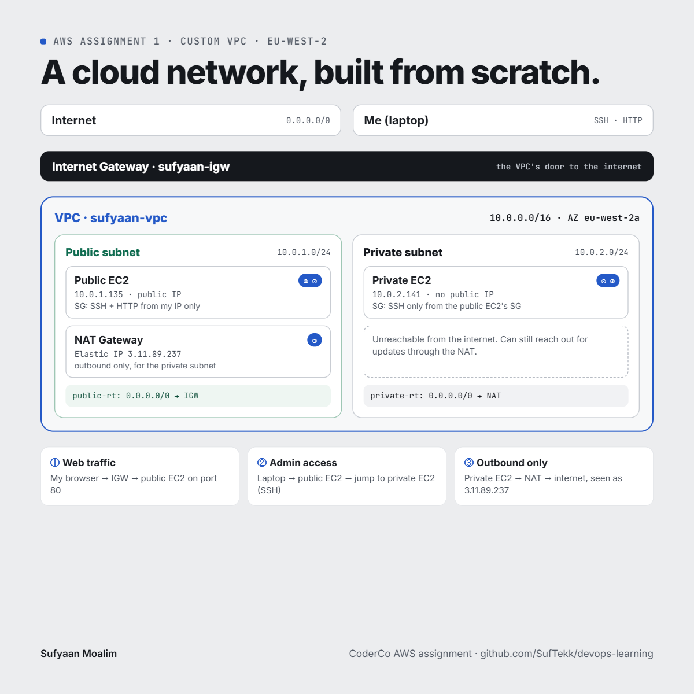
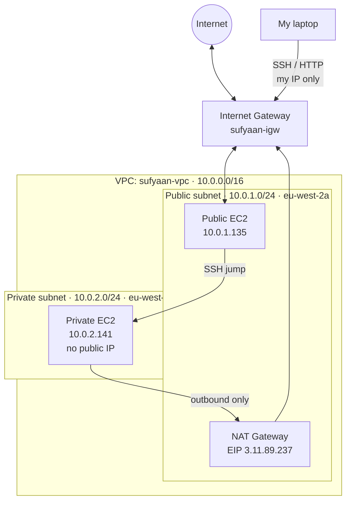
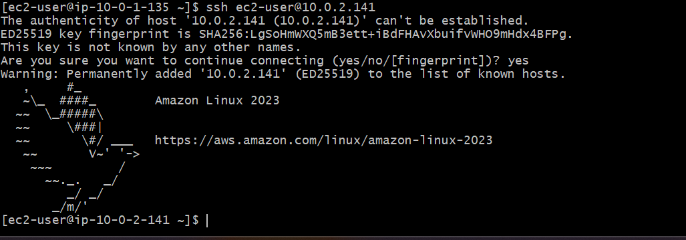
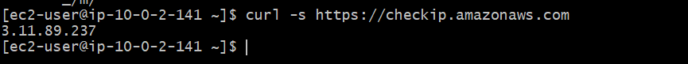

# Assignment 1: Custom VPC & Cloud Networking on AWS

A custom AWS network built from scratch: a VPC with public and private subnets, an Internet Gateway, a NAT Gateway, route tables, security groups and two EC2 instances. It shows how cloud traffic is routed, segmented and secured.

Built for the CoderCo AWS module, in the London region (eu-west-2).

---

## Architecture

### Resources

| Resource | Name | Configuration |
|---|---|---|
| VPC | `sufyaan-vpc` | `10.0.0.0/16` |
| Public subnet | `public-subnet-a` | `10.0.1.0/24`, eu-west-2a, auto-assign public IPv4 on |
| Private subnet | `private-subnet-a` | `10.0.2.0/24`, eu-west-2a, no public IPs |
| Internet Gateway | `sufyaan-igw` | Attached to the VPC |
| NAT Gateway | `sufyaan-nat` | In the public subnet, with an Elastic IP |
| Public route table | `public-rt` | `0.0.0.0/0 → IGW` |
| Private route table | `private-rt` | `0.0.0.0/0 → NAT Gateway` |
| Public EC2 SG | `public-ec2-sg` | SSH (22) and HTTP (80) from my IP only |
| Private EC2 SG | `private-ec2-sg` | SSH (22) only from `public-ec2-sg` |

---

## How it works

**What makes a subnet public?** Not the name, and not the public IPs. A subnet is public because its route table sends internet traffic (`0.0.0.0/0`) to an **Internet Gateway**.

**How does a private server get updates?** Its route table sends internet traffic to a **NAT Gateway** in the public subnet. The NAT lets the server reach out, but nothing on the internet can start a connection back in.

**How do I reach the private server?** Through the public EC2 as a jump host. The private server's security group only accepts SSH from instances in `public-ec2-sg`, using a **security group reference** rather than an IP range.

---

## Testing

| Test | How | Result |
|---|---|---|
| Public EC2 serves a page | `http://<public IP>` in a browser | ✅ Apache page served (installed via user data) |
| SSH into the public EC2 | `ssh -A ec2-user@<public IP>` | ✅ Connected (`ip-10-0-1-135`) |
| Jump to the private EC2 | `ssh ec2-user@10.0.2.141` from the public EC2 | ✅ Connected (`ip-10-0-2-141`) |
| Private EC2 reaches the internet via the NAT | `curl -s https://checkip.amazonaws.com` | ✅ Returned `3.11.89.237`, the **NAT's Elastic IP** |

I used **SSH agent forwarding** (`ssh-agent`, `ssh-add`, `ssh -A`) to hop between servers, so the private key never had to be copied onto a server.

| Inside the private EC2 | Outbound IP = the NAT's Elastic IP |
|---|---|
|  |  |

---

## Challenges and how I solved them

### 1. The public EC2 timed out in the browser

A timeout means traffic is being **dropped**, so I checked each layer in turn instead of changing things at random:

| Layer | Check | Result |
|---|---|---|
| VPC | Is the instance in `sufyaan-vpc`? | ✅ |
| Routing | Does `public-rt` have `0.0.0.0/0 → IGW`, associated with the public subnet? | ✅ |
| Firewall | Which security group is on the instance? | ❌ The VPC's **default** SG |

**Root cause:** the instance launched with the VPC's default security group, which only allows traffic from members of the same group, so my browser was silently blocked.

**Fix:** I swapped the instance's security group to `public-ec2-sg` (Actions → Security → Change security groups). The page loaded straight away, with no relaunch.

### 2. Running commands on the wrong machine

After SSHing in, I ran laptop commands (`ssh-add`, `cd ~/Downloads`) on the server, where the key doesn't exist. Now I always check the prompt first: `MINGW64` is my laptop, `ip-10-0-1-x` is the public EC2, and `ip-10-0-2-x` is the private EC2.

### 3. The Elastic IP wouldn't release

"Cannot be released with association IDs": the Elastic IP was still attached to the NAT Gateway's network interface while AWS finished deleting it. Waiting a few minutes, then releasing, fixed it. The lesson is to delete the NAT first and release the EIP after it's fully gone.

More detail: [notes.md](notes.md)

---

## Security decisions

- **Root account secured** with MFA. Day-to-day work is done as an IAM admin user with MFA.
- **Least privilege on every security group:** SSH and HTTP from my IP only, and the private server accepts SSH only from the public server's security group.
- **The private server has no public IP**, and no inbound path from the internet.
- **No private keys in the repo.** `*.pem` is in `.gitignore`.

---

## Cost and clean-up

NAT Gateways and Elastic IPs are billed **per hour**, so I deleted the NAT Gateway, released the Elastic IP and terminated both instances as soon as testing was done. The VPC, subnets, route tables and security groups are free, and are being reused for Assignment 2.

---

## What I learnt

- How a VPC, subnets, route tables, an Internet Gateway and a NAT Gateway fit together
- The difference between public and private subnets comes down to **routing**
- Security group references are more robust than IP rules for server-to-server access
- A **timeout** points to dropped traffic (routing or a firewall), so check the layers in order
- Cloud networking has a cost side: NAT and Elastic IPs should be cleaned up promptly
