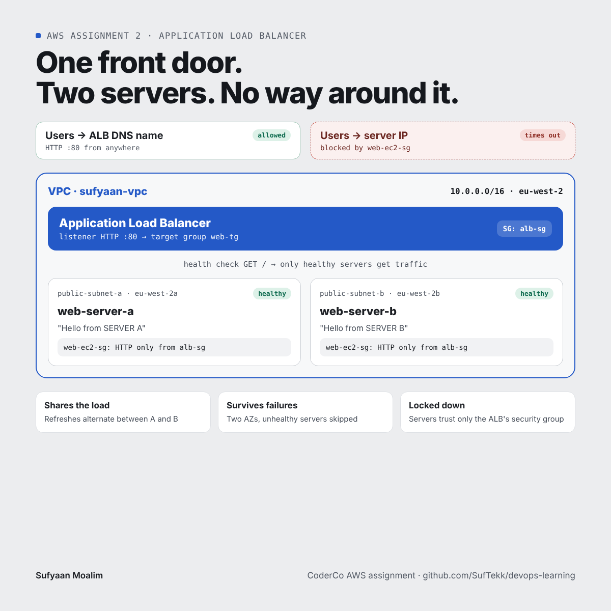
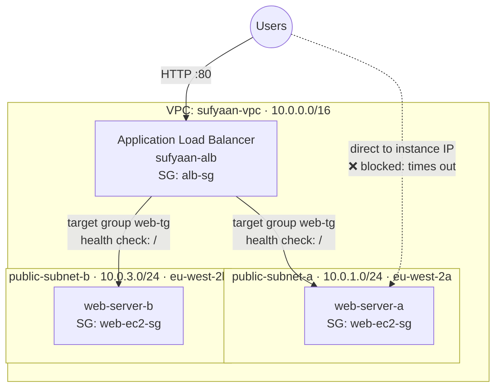
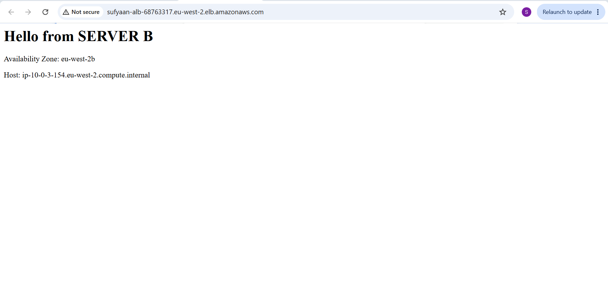
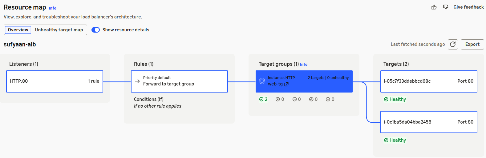
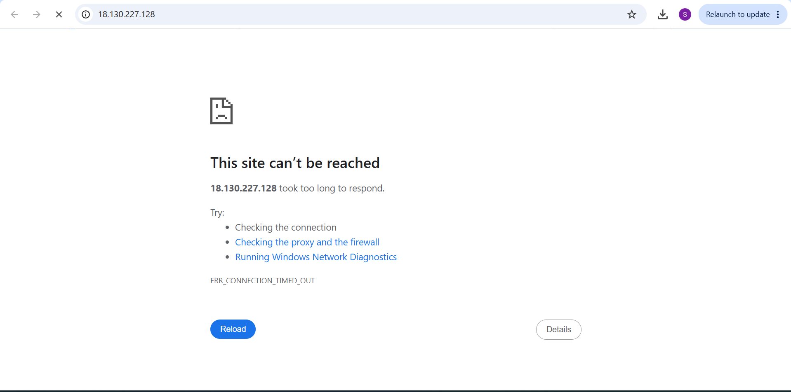
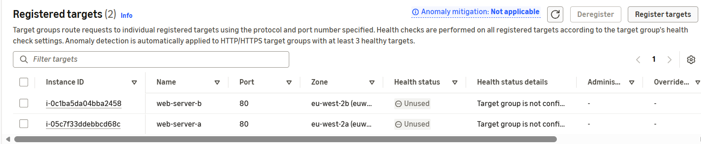
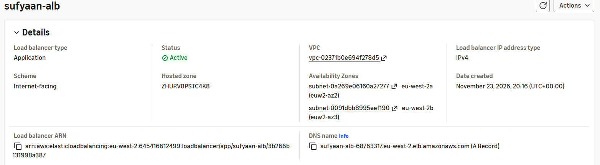

# Assignment 2: Application Load Balancer with Two EC2 Instances

Two web servers in different Availability Zones behind an AWS Application Load Balancer (ALB). The ALB handles all incoming traffic, health-checks the servers and spreads requests between them. The servers themselves can't be reached directly from the internet.

Built for the CoderCo AWS module, in the London region (eu-west-2), reusing the custom VPC from [Assignment 1](../assignment-1-vpc/).

---

## Architecture

### Resources

| Resource | Name | Configuration |
|---|---|---|
| Subnet (existing) | `public-subnet-a` | `10.0.1.0/24`, eu-west-2a |
| Subnet (new) | `public-subnet-b` | `10.0.3.0/24`, eu-west-2b, associated with `public-rt` (route to the IGW) |
| ALB security group | `alb-sg` | Inbound HTTP (80) from `0.0.0.0/0` |
| EC2 security group | `web-ec2-sg` | Inbound HTTP (80) **only from `alb-sg`**. No SSH. |
| EC2 instances | `web-server-a`, `web-server-b` | Amazon Linux, t3.micro, Apache installed via [user data](user-data/) |
| Target group | `web-tg` | HTTP:80, instance targets, health check path `/` |
| Load balancer | `sufyaan-alb` | Internet-facing, public subnets in eu-west-2a and eu-west-2b, HTTP:80 listener forwarding to `web-tg` |

---

## How it works

1. Users visit the **ALB's DNS name**, the single entry point for the application.
2. The ALB's **listener** on port 80 forwards requests to the **target group**.
3. The target group sends each request to a **healthy** server. The ALB checks `/` on each server regularly and stops sending traffic to any server that fails.
4. The servers' security group only accepts HTTP from **the ALB's security group**, so they're never exposed directly.

**Why two Availability Zones?** An ALB requires subnets in at least two AZs. If one AZ has problems, the ALB keeps serving from the other.

**Why do the servers have public IPs?** So they can download Apache on first boot, because there's no NAT Gateway in this setup (it was removed after Assignment 1 to save cost). The security group still blocks all direct access, as the test below shows.

---

## Testing

| Test | Result |
|---|---|
| Visit the ALB DNS name | ✅ Page served |
| Refresh repeatedly | ✅ Responses alternate between **SERVER A** and **SERVER B** |
| Target group health | ✅ Both targets **Healthy** |
| Visit a server's public IP directly | ✅ **Timed out**, so direct access is blocked by `web-ec2-sg` |

| Served through the ALB | Both targets healthy |
|---|---|
|  |  |

| Direct access to an instance: blocked ✅ |
|---|
|  |

| Target group | Load balancer |
|---|---|
|  |  |

---

## Challenges and how I solved them

### 1. Couldn't find the right Availability Zone

The AZ dropdown only showed options I didn't expect, and my VPC wasn't there. The console had **switched region** to Europe (Stockholm, `eu-north-1`). Everything I'd built lives in London (`eu-west-2`), and AWS regions are completely separate. I switched back to London. **Lesson:** check the region before building anything.

### 2. Leftover instances from Assignment 1

The Instances list showed five running instances. Two were from Assignment 1, and their termination hadn't gone through. Extra instances use up Free Tier hours, so I terminated them. **Lesson:** after clean-up, refresh and confirm each instance shows **Terminated**.

### 3. Making sure the new subnet was really public

A new subnet uses the VPC's main route table by default, which has no route to the internet. I explicitly associated `public-subnet-b` with `public-rt` (`0.0.0.0/0 → IGW`), so its server could download Apache and the ALB could use it.

---

## Security decisions

- **The servers only accept traffic from the load balancer** (a security group reference, not an IP range)
- **No SSH on the web servers**, and no key pair. User data does all the setup, so there's one less way in.
- **One public entry point:** the ALB, on port 80 only

---

## Cost and clean-up

The ALB is billed per hour. After testing, I deleted the load balancer and the target group, and terminated both instances. The VPC, subnets and security groups are free and were kept.

---

## What I learnt

- How an ALB, a listener, a target group and health checks fit together
- Why load balancers need multiple Availability Zones (high availability)
- **Security group chaining:** `web-ec2-sg` trusts `alb-sg`, which is the standard pattern for keeping servers private behind a load balancer
- A single DNS name in front of many servers means servers can be replaced or scaled without users noticing
- Always check the region, and confirm clean-up actually happened
