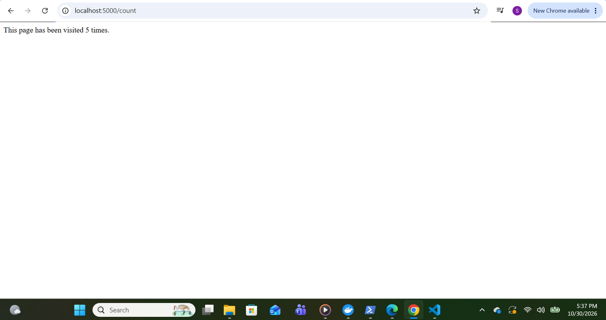
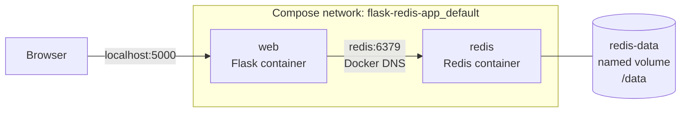

# Flask + Redis Multi-Container App with Docker Compose

A two-container application: a Python **Flask** web app that stores a visit counter in **Redis**, each built from its own Dockerfile and orchestrated with **Docker Compose**. Built for the CoderCo Containers challenge.



---

## Architecture



- Only **Flask's port 5000** is published to the host. **Redis has no published port**; it's only reachable inside the Compose network.
- Flask finds Redis by its **service name** (`redis`), which Docker's built-in DNS resolves to the container's IP.
- Redis data lives in a **named volume**, so it survives the containers being removed.

---

## Routes

| Route | What it does |
|---|---|
| `/` | Welcome page |
| `/count` | Increments a `visits` key in Redis (`INCR`) and shows the total |

---

## Project structure

```
flask-redis-app/
├── app.py               # Flask app (reads REDIS_HOST / REDIS_PORT from env, with defaults)
├── requirements.txt     # flask, redis
├── Dockerfile           # Flask image
├── redis/
│   └── Dockerfile       # Redis image (pinned to redis:7-alpine)
├── docker-compose.yml   # Runs both services + named volume
└── screenshots/
```

---

## How to run

```bash
docker compose up --build
```

Then open:
- http://localhost:5000/
- http://localhost:5000/count

Stop and remove the containers (the volume and the count are kept):

```bash
docker compose down
```

---

## Key decisions

| Decision | Why |
|---|---|
| **Copy `requirements.txt` before the app code** in the Flask Dockerfile | Layer caching: editing `app.py` doesn't re-run `pip install`, so rebuilds are much faster |
| **Pinned `redis:7-alpine`** rather than `latest` | Reproducible builds, plus a small image |
| **No `ports:` on Redis** | The browser only talks to Flask, so the database isn't exposed to the host (least privilege) |
| **`depends_on: redis`** | Redis starts before Flask |
| **Named volume at `/data`** | `/data` is where the official Redis image stores its data. A named volume persists independently of containers. |
| **`host="0.0.0.0"` in Flask** | So the app accepts connections from outside its container, not just from its own localhost |

---

## Proving persistence

| Test | Result |
|---|---|
| Count to N → `docker compose down` → `up` (**no volume**) | Count **reset to 1**. Data lived in the container's writable layer and was deleted with it. |
| Count to 6 → `docker compose down` → `up` (**with named volume**) | Count **continued at 7** ✅ |


---

## Challenges and how I solved them

### 1. Browser couldn't reach the Flask container
`docker ps` didn't list my container at all. `docker ps -a` showed `Exited (0)`: a **clean exit, not a crash**. The foreground container had been stopped from the terminal. I reran it **detached** with a name: `docker run -d --name myproject -p 5000:5000 flask-app`.

### 2. `/count` returned 500 Internal Server Error
`docker logs myproject` showed:
```
redis.exceptions.ConnectionError: Error -2 connecting to redis:6379. Name or service not known.
```
A 500 (not a timeout) meant the request **did** reach Flask; Flask's call to Redis failed. "Name or service not known" is a **DNS resolution failure**, because no container called `redis` existed. Docker Compose fixed this by creating both services on a shared network, where service names resolve via Docker's internal DNS.

### 3. `docker compose up` said "empty compose file"
The YAML was in the editor but **not saved to disk**, and Docker reads from disk. Saved the file, and it worked.

### 4. Port conflicts and leftover containers
`docker ps` showed containers from earlier lessons still running for days, one on port 5002. I stopped and removed my test container (`docker stop` + `docker rm`) before starting Compose, so port 5000 was free.

### 5. Folder name case
My folder was `Redis` while Compose referenced `./redis`. Windows doesn't care about case, but Linux does, so I renamed it to lowercase to keep it portable.

---

## What I learnt

- **Image vs container:** an image is the recipe; containers are instances made from it (one image → many containers).
- Containers are **isolated** (own filesystem, processes and IP) but **share the host kernel**. On Windows, Docker Desktop runs them in a lightweight Linux VM (WSL 2).
- Each container gets its **own private IP** (`172.17.x.x` on the default bridge, `172.20.x.x` on the Compose network), similar to private IPs in an AWS VPC.
- **`-p host:container`** publishes a container port to the host. Docker options go **before** the image name.
- **Exit codes:** `0` = clean stop, `137` = killed.
- `docker build` / `run` / `ps -a` / `logs` / `stop` / `rm`, and `docker compose up --build` / `down`.

---

## Next improvements

- [ ] Pass `REDIS_HOST` / `REDIS_PORT` explicitly via `environment:` in Compose (the app already reads them)
- [ ] Scale the web service (`docker compose up --scale web=3`) behind an NGINX load balancer
- [ ] Add a health check for Redis, and use `depends_on: condition: service_healthy`
- [ ] Replace the Flask dev server with Gunicorn
- [ ] Add a `.dockerignore`
