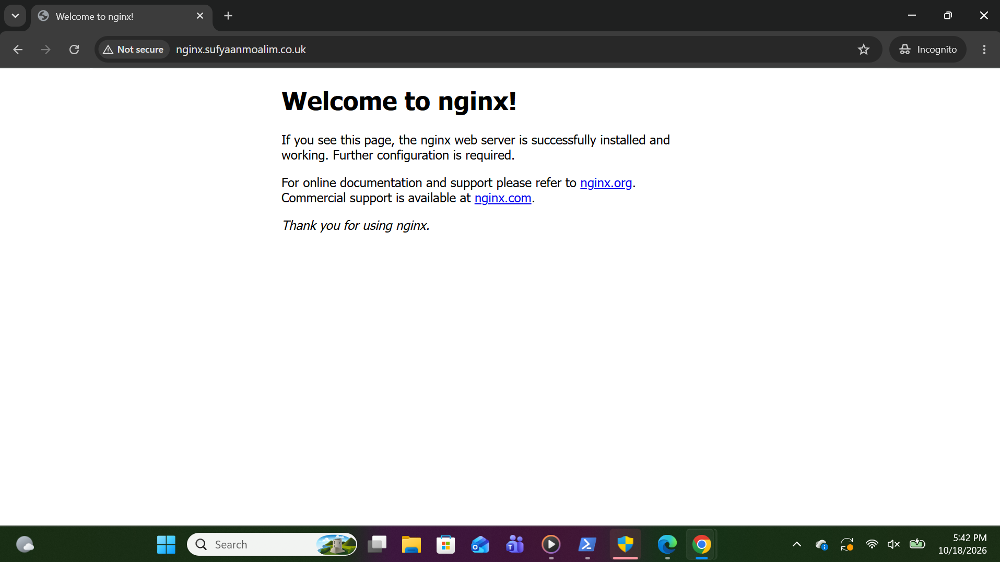
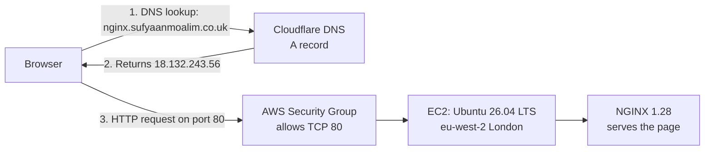
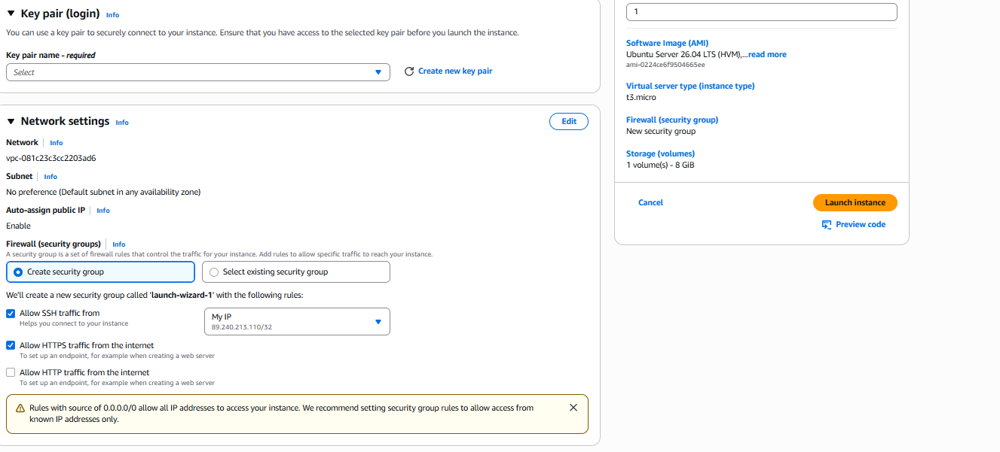
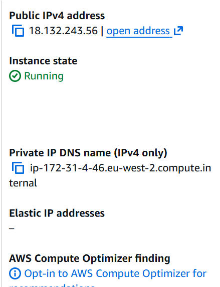
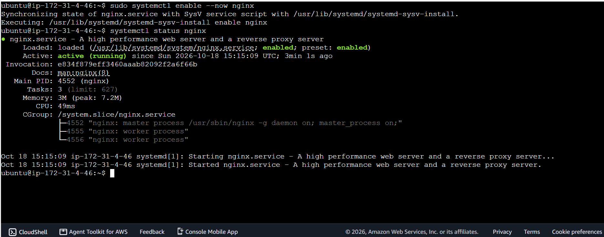
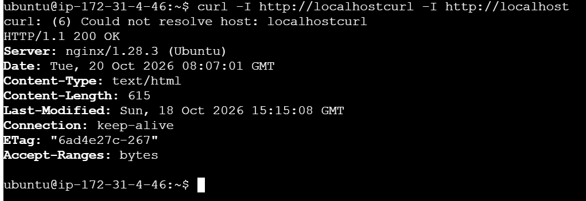
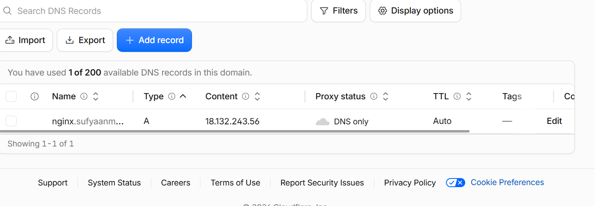
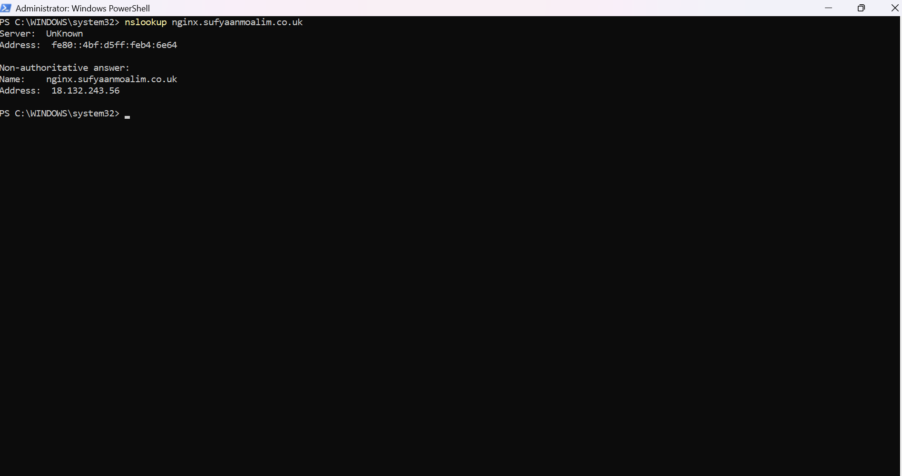

# Hosting NGINX on AWS EC2 with a Custom Domain

Deploying a Linux web server on AWS and serving it over my own domain, built to put networking fundamentals (IP addressing, DNS, routing, ports and firewalls) into practice.

**Live site:** http://nginx.sufyaanmoalim.co.uk

---

## Architecture

The browser asks DNS for the domain, Cloudflare's A record returns the EC2 public IP, the request travels over the internet to AWS, the security group allows it on port 80, and NGINX returns the page.

---

## Tech used

| Component | Choice |
|---|---|
| Cloud | AWS EC2 (eu-west-2, London) |
| Instance | Free-tier eligible instance |
| OS | Ubuntu Server 26.04 LTS |
| Web server | NGINX 1.28.3 |
| Domain + DNS | Cloudflare Registrar / Cloudflare DNS |

---

## What I built

1. **Registered a domain:** `sufyaanmoalim.co.uk` via Cloudflare, chosen so I can reuse it for future projects through subdomains.
2. **Launched an EC2 instance** running Ubuntu 26.04 LTS, with a security group allowing HTTP from anywhere and SSH only from restricted sources.
3. **Connected to the server** using EC2 Instance Connect (after troubleshooting, see below).
4. **Installed and started NGINX** and enabled it to start on boot.
5. **Verified NGINX locally** with `curl -I http://localhost` → `HTTP/1.1 200 OK`.
6. **Verified public access** via the EC2 public IP in a browser.
7. **Created a DNS A record:** `nginx.sufyaanmoalim.co.uk → 18.132.243.56` (DNS only, not proxied).
8. **Verified DNS resolution** with `nslookup`, then loaded the site over the domain.

All commands are in [commands.md](commands.md).

### Evidence

| Step | Screenshot |
|---|---|
| EC2 launch configuration |  |
| Instance running |  |
| Connected to the server |  |
| NGINX service running |  |
| curl returns 200 OK |  |
| Site loads via public IP |  |
| Cloudflare A record |  |
| DNS lookup resolves |  |
| Site loads via domain |  |

---

## Security decisions

- **HTTP (80) open to 0.0.0.0/0:** the website is meant to be public.
- **SSH (22) never opened to the internet:** restricted to my own IP and to the AWS-managed EC2 Instance Connect prefix list for eu-west-2.
- **Least privilege on ports:** removed an unnecessary HTTPS (443) rule, as nothing was listening on it yet.
- **No secrets in the repo:** private keys (`.pem`) are excluded, and account IDs and personal IPs are blurred in screenshots.

---

## Challenges and how I solved them

### 1. EC2 Instance Connect failed
SSH was restricted to "My IP". When the connection failed, I first suspected my IP had changed after switching networks and updated the rule, but it still failed. The root cause was that browser-based EC2 Instance Connect connects from **AWS's service IP range**, not my machine. I fixed it by allowing the AWS-managed prefix list `com.amazonaws.eu-west-2.ec2-instance-connect`, without opening SSH to everyone.

### 2. Website timed out from the browser
`curl localhost` returned 200 OK, so NGINX was fine, but the browser timed out. Working internally but not externally pointed to the network layer. The security group allowed **HTTPS (443)** instead of **HTTP (80)**, and AWS silently drops disallowed traffic, which explains the timeout. Reviewing my launch screenshot showed that I'd ticked the HTTPS option instead of HTTP when creating the instance. I changed the rule to HTTP 80, and the site loaded.

Full write-up: [troubleshooting.md](troubleshooting.md)

---

## What I learnt

- How DNS, IP addressing, routing, ports and firewalls work together to deliver a single web request.
- The difference between **public and private IPs**: `172.31.x.x` is only reachable inside the VPC, while the public IP is reachable from the internet.
- **A records** map a hostname to an IPv4 address, and **non-authoritative** DNS answers come from a resolver's cache.
- **Security groups** are stateful firewalls that silently drop traffic, so a **timeout usually means a firewall**, not a broken application.
- Troubleshooting **from the inside out**: service → host → network.
- Checking service health on Linux with `systemctl status` (loaded / enabled / active).

---

## Cost and clean-up

- Runs on the AWS Free Tier. Public IPv4 and storage usage are monitored in Billing.
- **Stopping** the instance keeps the disk but **changes the public IP**, so the A record must then be updated.
- **Terminating** permanently deletes the server.

---

## Next improvements

- [ ] Add **HTTPS** with a free Let's Encrypt certificate (Certbot)
- [ ] Use an **Elastic IP** so the address survives stop/start
- [ ] Serve a **custom page** instead of the NGINX default
- [ ] Provision the whole setup with **Terraform** (infrastructure as code)
- [ ] Automate deployment with **GitHub Actions**
