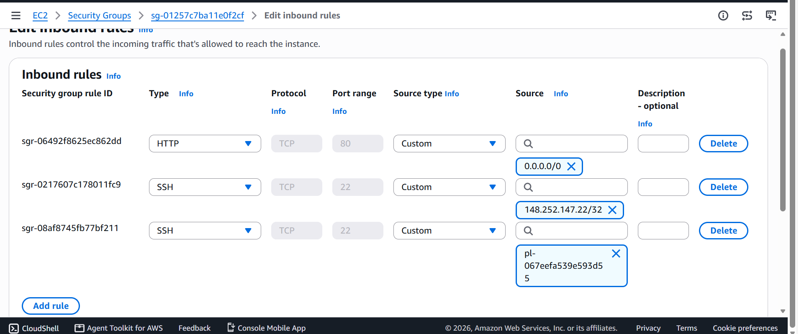
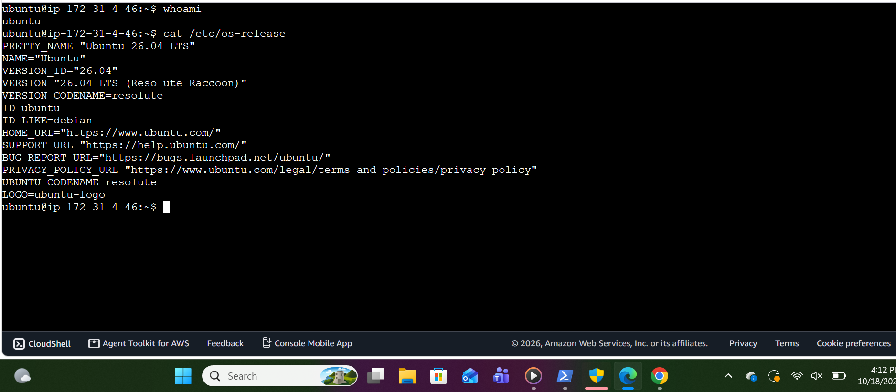
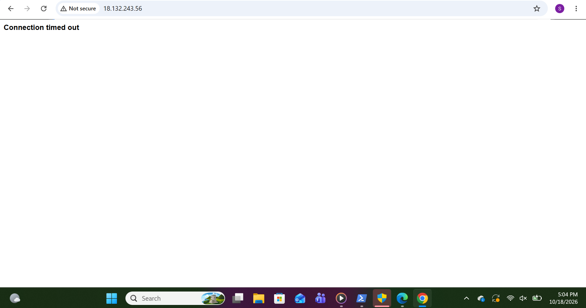
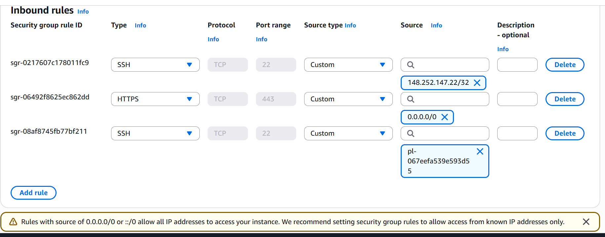
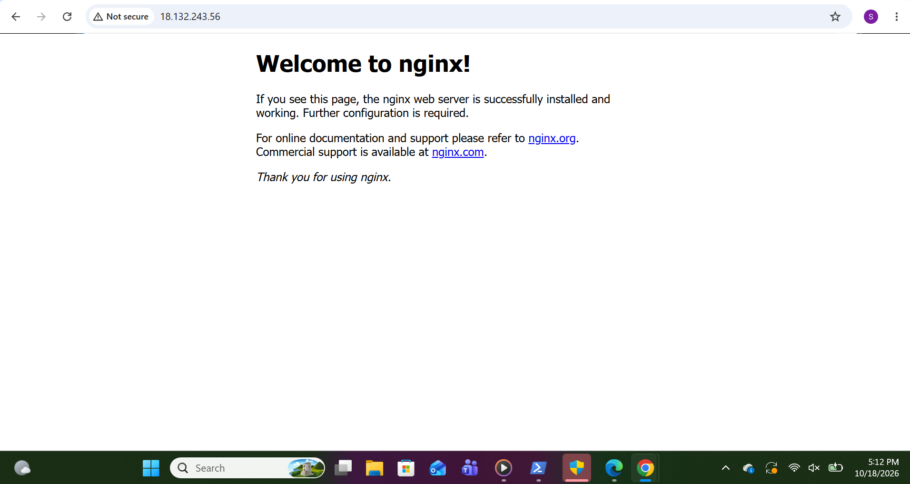

# Troubleshooting Log

Two real issues I hit while deploying NGINX on EC2, and how I diagnosed them.

---

## Issue 1: EC2 Instance Connect failed

**Symptom**
Connecting via *EC2 → Connect → EC2 Instance Connect* failed, after it had worked the day before.

**Setup at the time**
Security group SSH rule: TCP 22 from "My IP" (`x.x.x.x/32`).

**First hypothesis: my public IP had changed**
I was on a different Wi-Fi network, so my public IP was likely different from the one in the rule.
- Action: updated the SSH rule source to "My IP" again.
- Result: **still failed**, so the hypothesis was incomplete.

**Root cause**
Browser-based EC2 Instance Connect doesn't connect from my computer. The SSH connection to the instance comes from **AWS's EC2 Instance Connect service IP range** for the region. My security group only allowed my own IP, so it was correctly blocking AWS.

**Fix**
Added an inbound SSH rule using the AWS-managed prefix list:

| Type | Port | Source |
|---|---|---|
| SSH | 22 | `com.amazonaws.eu-west-2.ec2-instance-connect` |

**Why not 0.0.0.0/0?**
Opening SSH to the whole internet would expose the login service to constant automated attacks. The prefix list allows only the AWS service that needs access.

**Verification**
Connected successfully and ran `whoami` → `ubuntu`.

| Rules with the prefix-list fix | Connected |
|---|---|
|  |  |

---

## Issue 2: Website timed out from the browser

**Symptom**
`http://18.132.243.56` returned **"Connection timed out"** in the browser.

**Isolating the layer (inside out)**

| Check | Result | Conclusion |
|---|---|---|
| `systemctl status nginx` | active (running) | Service is up |
| `curl -I http://localhost` | HTTP/1.1 200 OK | NGINX serves pages on the host |
| Incognito + explicit `http://` | Still timed out | Not a browser HTTPS-upgrade issue |
| EC2 Instance Connect works | Yes | Routing to the instance is fine |
| Security group inbound rules | HTTPS 443 allowed, **no HTTP 80** | **Root cause found** |

**Root cause**
The security group had an **HTTPS (443)** rule instead of **HTTP (80)**. Security groups silently drop traffic that isn't allowed, so the browser never got a response and eventually timed out (rather than receiving a "connection refused" error).

**Where it came from**
Reviewing my launch screenshot (`screenshots/02-ec2-launch-configuration.png`) showed that at launch I had ticked **"Allow HTTPS traffic from the internet"** instead of **"Allow HTTP traffic from the internet"**. The two options sit next to each other, so it was an easy mix-up. Lesson: double-check the security group summary before launching.

**Fix**
Changed the rule type from HTTPS to **HTTP (TCP 80), source 0.0.0.0/0**. I didn't keep 443 open, because nothing listens on it yet (least privilege).

**Verification**
The browser loaded "Welcome to nginx!" via the public IP.

| Before | Fix | After |
|---|---|---|
|  |  →  |  |

---

## Lessons

- Troubleshoot **from the inside out**: service → host → network.
- **Timeout ≈ traffic dropped** (firewall/security group). **Connection refused ≈ reached the host, but nothing is listening on that port.**
- When a fix doesn't work, revisit the hypothesis rather than loosening security.
