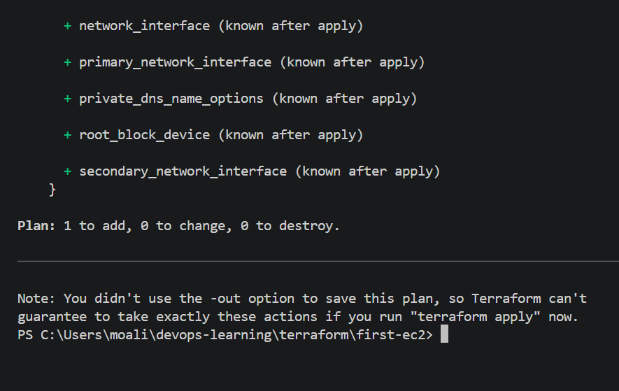
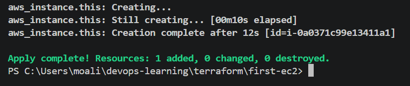

# First EC2 Instance with Terraform

My first infrastructure-as-code project: an AWS EC2 instance defined in Terraform, then created and destroyed from the command line instead of by clicking through the AWS console.

Built for the CoderCo Terraform module, in the London region (eu-west-2).

> **Status:** the instance was destroyed after testing to avoid costs. Running `terraform apply` recreates it exactly. That's the point of infrastructure as code.

---

## What it builds

| Resource | Details |
|---|---|
| `data.aws_ami.amazon_linux` | Looks up the latest Amazon Linux 2023 AMI in the current region (read-only, creates nothing) |
| `aws_instance.this` | A `t3.micro` EC2 instance using that AMI, tagged `Name = sufyaan-terraform-ec2` |

## Files

| File | Purpose |
|---|---|
| `provider.tf` | Requires the AWS provider (pinned to `6.74.0`) and sets the region to `eu-west-2` |
| `ec2.tf` | The AMI lookup (data source) and the EC2 instance (resource) |
| `.terraform.lock.hcl` | Locks the exact provider version, so every run uses the same one |

Not committed, and blocked by `.gitignore`: `.terraform/` (the downloaded provider), and `*.tfstate` (state files can contain sensitive data).

---

## How to run it

**Prerequisites:** Terraform installed (on Windows: `winget install Hashicorp.Terraform`), and AWS CLI credentials for an IAM user (`aws configure`). Never use the root account.

```bash
terraform init       # download the AWS provider
terraform validate   # check the code for errors
terraform plan       # preview: "Plan: 1 to add, 0 to change, 0 to destroy"
terraform apply      # create the instance (type "yes")
terraform destroy    # remove everything this project created (type "yes")
```

---

## Evidence

| Step | Screenshot |
|---|---|
| `terraform plan` |  |
| `terraform apply` |  |
| Instance running in the console |  |

After testing, `terraform destroy` removed the instance: `Destroy complete! Resources: 1 destroyed.`

---

## Challenges and how I solved them

### 1. `InvalidAMIID.NotFound`
I started from an example in the Terraform Registry docs that hardcoded an AMI ID from `us-west-2`. AMI IDs are **different in every region**, so London had no image with that ID.

**Fix:** replaced the hardcoded ID with a `data "aws_ami"` lookup that finds the latest Amazon Linux 2023 image in whichever region the provider uses. The code now works in any region and doesn't go out of date. (That example also used a Dedicated Host and an `m5.large`, both expensive and outside the Free Tier, so I switched to a `t3.micro`.)

### 2. `Unclosed configuration block`
A missing closing `}` after pasting the code. **Fix:** matched every `{` with a `}`, and now I run `terraform validate` before every plan.

### 3. `UnauthorizedOperation` on `ec2:DescribeImages`
My credentials worked (**authentication**), but my IAM user's group had no policy attached, so it had no permissions (**authorisation**). IAM denies everything unless a policy allows it.

**Fix:** attached a policy to the IAM group. (For a learning account I used `AdministratorAccess`. In a real environment, Terraform's role would get only the permissions it needs.)

### 4. Installing Terraform on Windows
The course installs Terraform with Homebrew, which is macOS/Linux only. **Fix:** installed it with `winget`, then restarted VS Code so its terminal picked up the new PATH.

---

## What I learnt

- The difference between **data sources** (look things up) and **resources** (create things)
- The Terraform workflow: **init → validate → plan → apply → destroy**
- **State** is Terraform's record of what it built. That's why `destroy` removed only this instance and left my manually built NGINX server untouched.
- Pinning provider versions keeps runs consistent
- State files and credentials must never go in Git
- Authentication vs authorisation in IAM

## Next

Variables, outputs, and building a full VPC with Terraform, rebuilding my [AWS assignments](../../aws/) as code.
